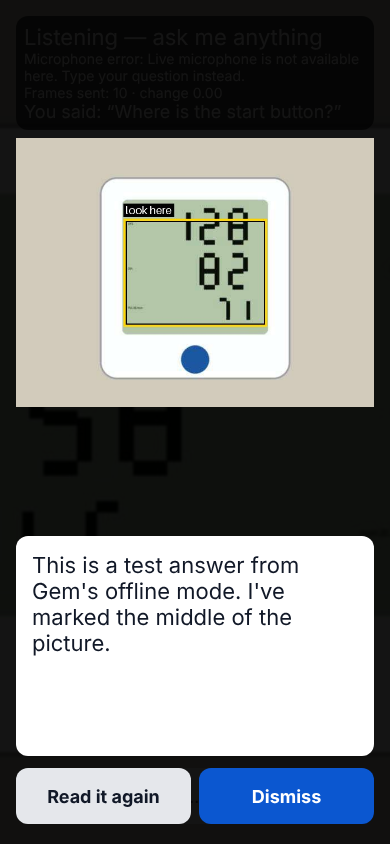
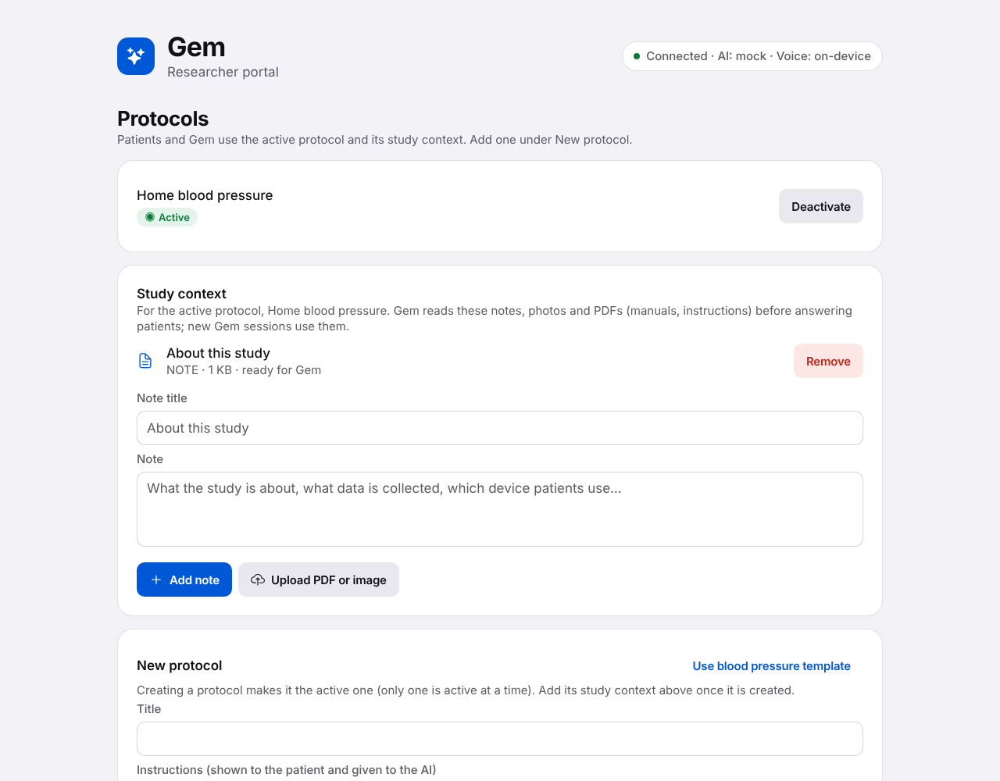

# Gem

**A camera + voice assistant for decentralized clinical trials.** Open the app, point the
camera, and ask. Gem watches through the camera (one frame per second), listens, and when
you stop talking it answers with **a photo of what you're looking at with the relevant
things marked**, plus a short answer read aloud.

<p>
<picture>
  <source media="(prefers-color-scheme: dark)" srcset="docs/screenshots/gem-answer-dark.png">
  
</picture>
<picture>
  <source media="(prefers-color-scheme: dark)" srcset="docs/screenshots/portal-top-dark.png">
  
</picture>
</p>

| Component | Where |
|-----------|-------|
| Gem app (Expo Go) + researcher portal (web) | `mobile/` — Expo SDK 57, one codebase, `Platform.OS` switch |
| Gem's context window, Gemini call, drawing, voice cache | `backend/app/assistant/` |
| Protocols, deterministic gateway (`POST /ingest_vitals`) | `backend/app/` |

App behavior: [docs/ASSISTANT_SPEC.md](docs/ASSISTANT_SPEC.md) · HTTP: [docs/API_CONTRACT.md](docs/API_CONTRACT.md) ·
UI handoff: [docs/UI_CONTRACT.md](docs/UI_CONTRACT.md) · Gateway: [docs/SPEC.md](docs/SPEC.md), [docs/PERFORMANCE.md](docs/PERFORMANCE.md)

## Quick start

Requirements: Python 3.12+, Node 20+, Expo Go (SDK 57) on a phone on the same Wi-Fi.

```bash
# 1. Backend
cd backend
python -m venv .venv && .venv/bin/pip install -r requirements.txt
cp .env.example .env            # add GEMINI_API_KEY / ELEVENLABS_API_KEY (or set GEM_MOCK_AI=1)
.venv/bin/uvicorn app.main:get_app --factory --host 0.0.0.0 --port 8000

# 2. App (new terminal)
cd mobile
npm install
echo "EXPO_PUBLIC_API_URL=http://<your-laptop-LAN-IP>:8000" > .env
npx expo start                  # press w → researcher portal; scan QR in Expo Go → Gem app
```

On the phone: allow camera + microphone, point at something, ask a question out loud
("What does this screen say?"), and stop talking. Gem shows the marked photo, the answer in
a text box, and reads it out; **Read again** replays without another ElevenLabs charge;
**Dismiss** (or dragging the photo down) returns to the camera. Gem doesn't listen while it
speaks; once it finishes you can ask a follow-up or correct it ("no, the other chair").

Optional: in the portal, create a protocol under **Protocols → New protocol** ("Use blood
pressure template → Create and activate"), then use **Study context** to add notes, photos
and PDF manuals. Gem reads them (and the protocol text) for every question in sessions
started while that protocol is active.

Gem pauses itself: after a minute with no movement, speech or scene change it stops
sending frames; after ten minutes it ends the session and forgets everything. Pick up the
phone or speak to wake it. Researchers can change both times under **Settings** at the
bottom of the portal. The app and the portal follow the system's light or dark mode.

No keys? Leave them empty (or `GEM_MOCK_AI=1`): Gem gives a fixed test answer with a box in
the middle and the phone uses its built-in voice. The live microphone works in Expo Go on
a phone, not in the web preview (`http://localhost:8081/?patient`), which shows the camera
screen only.

No shared LAN? See HUMAN_TESTS §0 (VPN or tunnels).

## Reproducing the measurements (judges)

```bash
cd backend
.venv/bin/pytest tests/test_gateway.py                    # correctness invariants (46 tests)
.venv/bin/pytest                                          # full backend suite, no network
.venv/bin/python load_test.py --workers 50 --events 1000  # p50/p95/p99 µs + exactly-once check
```

Sample on a 4-vCPU container: gateway validation **p95 34 µs** in-server (2.4 µs warm
micro-benchmark), end-to-end HTTP + SQLite 2.2 ms p50 uncontended; 800/800 unique readings
stored exactly once, 118/118 hallucinated values rejected. Details and caveats in
[docs/PERFORMANCE.md](docs/PERFORMANCE.md).

## All checks

```bash
./scripts/check.sh   # backend pytest + load-test smoke + mobile typecheck, lint, jest
```

## How it stays trustworthy

- **No keys on the phone:** Gemini and ElevenLabs are called only by the backend.
- **Gem's context is in RAM only** and is purged after 10 minutes without frames or questions.
- **Gemini never edits the photo:** it returns boxes, the server draws them.
- **Gateway (legacy capture flow):** the app holds no keys and never submits vitals; it uploads a
  photo and confirms a server-held capture.
- **Gemini is untrusted:** structured JSON output is parsed strictly (box must be on the
  0–1000 grid, only the protocol's metrics, numbers only) or the frame is dropped.
- **Deterministic gateway:** plausibility limits reject AI misreads (422), expected-range
  limits flag-and-store real outliers, cross-field rules (systolic > diastolic), and
  idempotency keys with UNIQUE constraints give exactly-once storage (409 on replays).
- **Human in the loop:** the patient hears a deterministic read-back and confirms.

Not HIPAA / 21 CFR Part 11 compliant; no auth; synthetic data only (see SPEC §2).

## Repository layout

```
backend/   FastAPI app, gateway, AI adapters, tests, load_test.py, fixtures, scripts
mobile/    Expo app: src/{api,hooks,logic,services,ui,screens,__tests__}
docs/      SPEC, API_CONTRACT, UI_CONTRACT, TASKS, DECISIONS, HUMAN_TESTS, PERFORMANCE, PITCH
scripts/   check.sh
CLAUDE.md  instructions for coding agents
```

## License

[MIT](LICENSE) © 2026 Ali Azam, Diya Shah, Nithin Sai Ega
