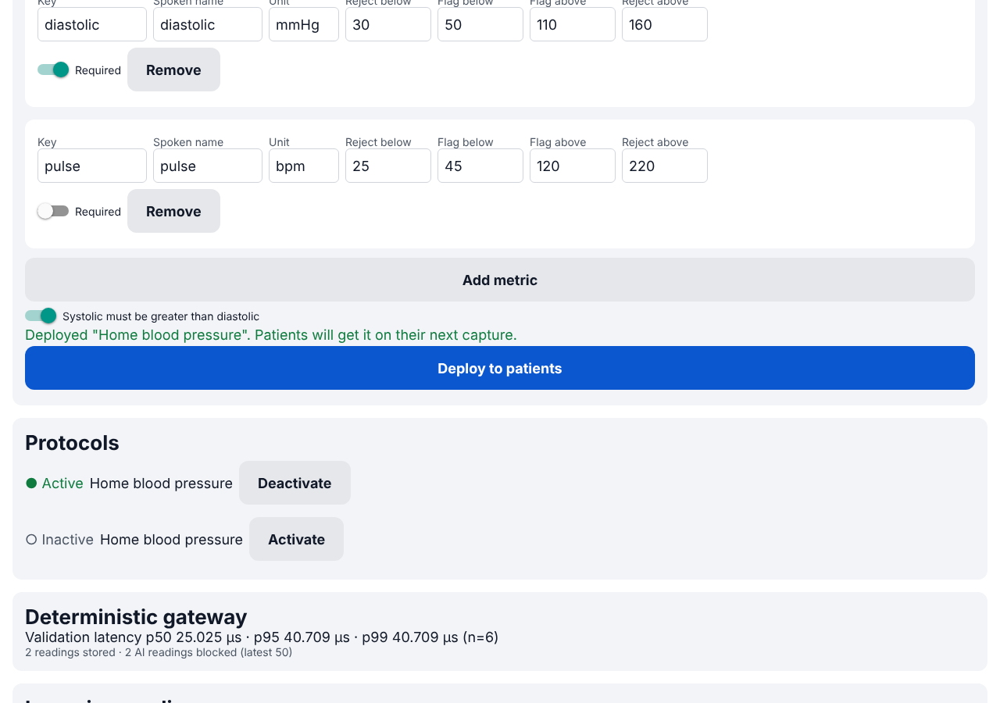

# Gem

**Voice-guided camera workflows for decentralized clinical trials.** A researcher deploys a
protocol step from a web portal; the patient points their phone at a device, Gemini reads
it, an ElevenLabs voice reads it back, and a deterministic gateway validates the numbers
before anything is stored.

<p>


</p>

| Component | Where |
|-----------|-------|
| Researcher portal (web) + patient app (Expo Go) | `mobile/` — Expo SDK 57, one codebase, `Platform.OS` switch |
| AI pipeline (Gemini vision → ElevenLabs voice) | `backend/app/vision.py`, `backend/app/voice.py` |
| Deterministic gateway (`POST /ingest_vitals`) | `backend/app/gateway.py`, `backend/app/ingest.py` |

Full behavior: [docs/SPEC.md](docs/SPEC.md) · HTTP: [docs/API_CONTRACT.md](docs/API_CONTRACT.md) ·
Performance: [docs/PERFORMANCE.md](docs/PERFORMANCE.md) · UI handoff: [docs/UI_CONTRACT.md](docs/UI_CONTRACT.md)

## Quick start

Requirements: Python 3.12+, Node 20+, Expo Go (SDK 57) on a phone on the same Wi-Fi.

```bash
# 1. Backend
cd backend
python -m venv .venv && .venv/bin/pip install -r requirements.txt
cp .env.example .env            # add GEMINI_API_KEY / ELEVENLABS_API_KEY (or set GEM_MOCK_AI=1)
.venv/bin/uvicorn app.main:get_app --factory --host 0.0.0.0 --port 8000

# 2. App (new terminal)
cd mobile
npm install
echo "EXPO_PUBLIC_API_URL=http://<your-laptop-LAN-IP>:8000" > .env
npx expo start                  # press w → researcher portal; scan QR in Expo Go → patient app
```

In the portal: **Use blood pressure template → Deploy to patients**. On the phone: point at
the monitor → **Read my device** → listen → **Yes, that's right**. The reading appears in the
portal.

No keys? Leave them empty (or `GEM_MOCK_AI=1`): the backend uses a deterministic mock
reader and the phone speaks with on-device TTS. Cover the lens to see the retake path;
set `GEM_MOCK_READINGS='{"systolic": 900, "diastolic": 82}'` to watch the gateway block a
hallucination.

## Reproducing the measurements (judges)

```bash
cd backend
.venv/bin/pytest tests/test_gateway.py                    # correctness invariants (46 tests)
.venv/bin/pytest                                          # full backend suite, no network
.venv/bin/python load_test.py --workers 50 --events 1000  # p50/p95/p99 µs + exactly-once check
```

Sample on a 4-vCPU container: gateway validation **p95 34 µs** in-server (2.4 µs warm
micro-benchmark), end-to-end HTTP + SQLite 2.2 ms p50 uncontended; 800/800 unique readings
stored exactly once, 118/118 hallucinated values rejected. Details and caveats in
[docs/PERFORMANCE.md](docs/PERFORMANCE.md).

## All checks

```bash
./scripts/check.sh   # backend pytest + load-test smoke + mobile typecheck, lint, jest
```

## How it stays trustworthy

- **Zero-trust frontend:** the app holds no keys and never submits vitals; it uploads a
  photo and confirms a server-held capture.
- **Gemini is untrusted:** structured JSON output is parsed strictly (box must be on the
  0–1000 grid, only the protocol's metrics, numbers only) or the frame is dropped.
- **Deterministic gateway:** plausibility limits reject AI misreads (422), expected-range
  limits flag-and-store real outliers, cross-field rules (systolic > diastolic), and
  idempotency keys with UNIQUE constraints give exactly-once storage (409 on replays).
- **Human in the loop:** the patient hears a deterministic read-back and confirms.

Not HIPAA / 21 CFR Part 11 compliant; no auth; synthetic data only (see SPEC §2).

## Repository layout

```
backend/   FastAPI app, gateway, AI adapters, tests, load_test.py, fixtures, scripts
mobile/    Expo app: src/{api,hooks,logic,services,ui,screens,__tests__}
docs/      SPEC, API_CONTRACT, UI_CONTRACT, TASKS, DECISIONS, HUMAN_TESTS, PERFORMANCE, PITCH
scripts/   check.sh
CLAUDE.md  instructions for coding agents
```
